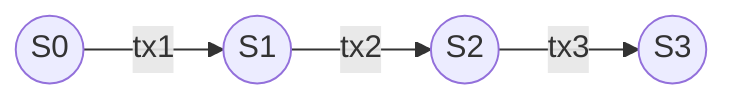
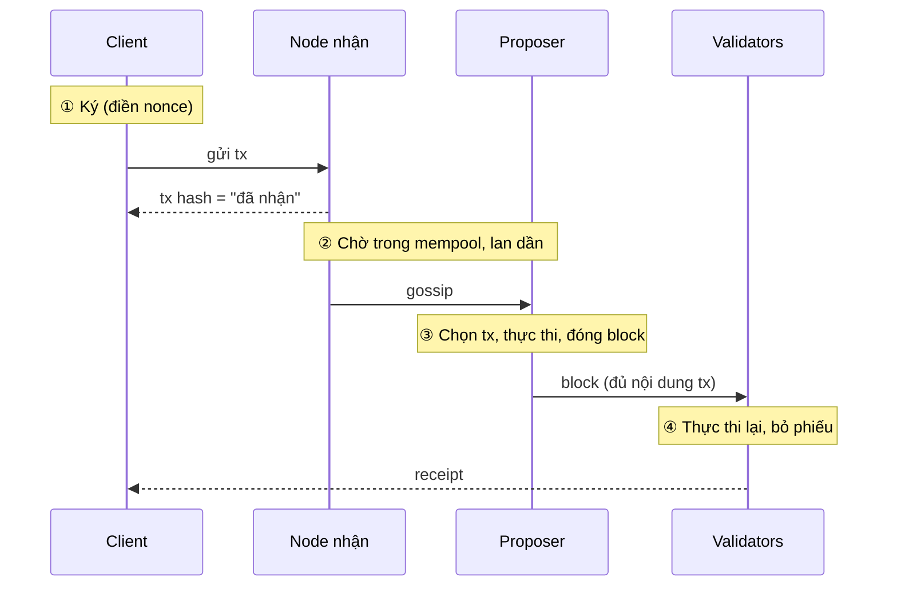
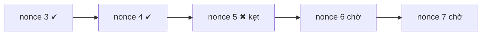
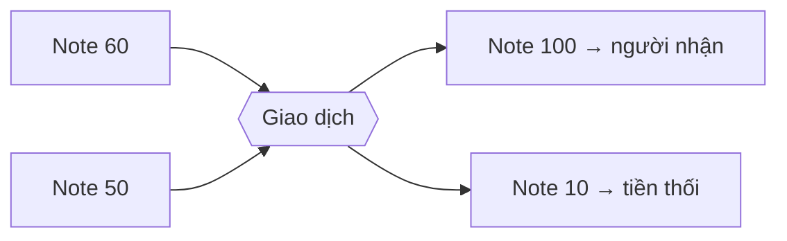
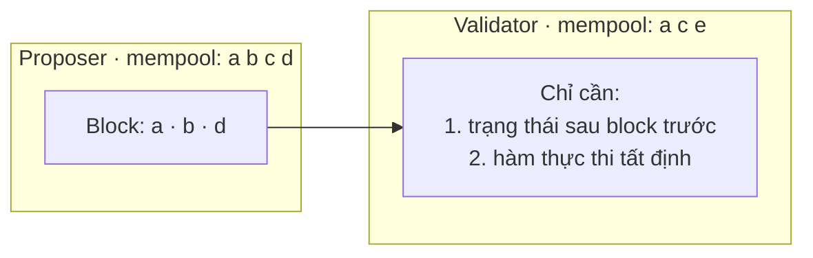
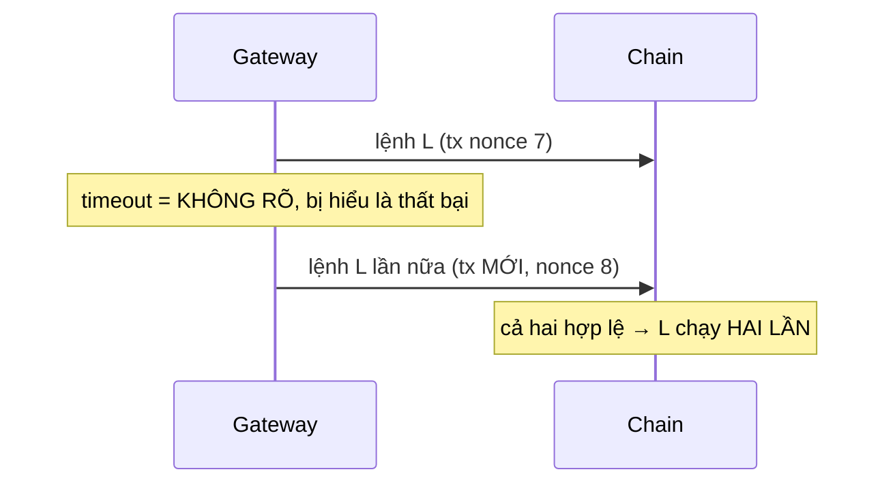

# Vòng đời một transaction: từ nonce, mempool, block time đến tính đúng đắn trong wCBDC

*Viết 2026-11-17. Bản slide đi kèm: `2026-11-17-vong-doi-transaction-block-time-va-tinh-dung-dan-slides.html`.*

Bài bắt đầu từ năm thắc mắc: hạ block time có confirm nhanh hơn không; nonce có phải để sắp thứ tự không; mempool các node lệch nhau thì đồng thuận có hỏng không; block time là config hay hệ quả; và nếu coi chain là một database thì nó yếu ở đâu, nhất là với wCBDC.

Năm câu này có chung một gốc: **một transaction đi qua những đâu, và vì sao phải đi qua đó**. Vì vậy bài dựng lại con đường ấy trước (§1–§2), rồi trả lời từng thắc mắc tại đúng chặng nó nằm (§3–§9).

## 1. Gốc: nhiều máy, một cuốn sổ

Bài toán gốc là nhiều máy của nhiều tổ chức cùng giữ một cuốn sổ, không máy nào được một mình quyết nội dung. So sổ liên tục với nhau thì không khả thi. Lối thoát nằm ở một quan sát: nếu việc cập nhật sổ là **tất định** (cùng trạng thái, cùng giao dịch thì máy nào cũng ra cùng kết quả), các máy chỉ cần chạy cùng một dãy giao dịch theo cùng một thứ tự là tự khắc giống nhau.



Nhờ đó toàn bộ bài toán thu về một việc duy nhất: **thống nhất thứ tự**. Ba khái niệm quen thuộc chỉ là ba bộ phận của cỗ máy làm việc đó:

| Bộ phận | Vai trò |
|---|---|
| **Mempool** | Phòng chờ của giao dịch chưa có thứ tự. Mỗi node một phòng riêng |
| **Block** | Một *đề xuất* thứ tự cho một lô giao dịch, kèm cam kết về kết quả |
| **Đồng thuận** | Thủ tục để mọi node chấp nhận cùng một block |

Vì sao gom lô mà không thống nhất từng giao dịch? Vì mỗi lần thống nhất tốn chi phí cố định (vài vòng tin nhắn, chữ ký, ghi đĩa), nên gom lô để chia chi phí ấy ra. Trực giác "block time là thời gian gom batch" sinh ra từ đây. Nó đúng, nhưng mới một nửa; nửa còn lại phải đi hết con đường mới thấy (§5).

## 2. Bốn chặng của một transaction



Ở mỗi chặng, điều đáng nhớ là *ai đang nắm quyền* và *điều gì chưa được bảo đảm*.

**① Ký.** Client dựng giao dịch, điền nonce và ký lên tất cả. Hai chi tiết sẽ quay lại về sau: giao dịch **không mang timestamp** (thời gian chỉ có ở header block, do người đóng block ghi), và nonce nằm **trong phần được ký** nên không node nào sửa được.

**② Chờ.** Node nhận kiểm tra chữ ký, nonce, số dư, cho giao dịch vào mempool của mình và trả về tx hash. Tx hash chỉ có nghĩa "node này đã nhận". Giao dịch lan dần sang các node khác, nhưng không có gì bảo đảm mọi node đều có nó. Mempool lại có giới hạn: đầy thì đuổi bớt, restart thì mất. Đây là chặng mà giao dịch có thể biến mất không ai báo.

**③ Thành block.** Mỗi độ cao có một node được quyền đề xuất: người giải được bài băm (PoW), validator được chọn cho slot (PoS), hoặc người đến lượt xoay vòng (BFT). Node đó lấy giao dịch **từ mempool của chính mình**, tự sắp thứ tự, thực thi rồi đóng block. Giao dịch chạy lỗi vẫn nằm trong block và vẫn tốn nonce. Block phát đi mang **đủ nội dung giao dịch**, không chỉ hash.

**④ Thành sự thật.** Mỗi validator tự thực thi lại block và so kết quả; không ai tin người đề xuất. Khớp thì bỏ phiếu, đủ quorum thì ghi vào chain.

Còn một câu hỏi treo lại: block đã ghi thì có bị đảo không? Câu trả lời tuỳ họ đồng thuận, và sẽ là mấu chốt của nửa sau bài: PoW không bao giờ chắc tuyệt đối, Ethereum chắc sau khoảng 13 phút, còn BFT chắc **ngay khi vào block**.

## 3. Nonce (chặng ①)

Trực giác "nonce để sắp thứ tự" gần đúng nhưng đảo nhân quả. Giao dịch kiểu account là một *mệnh lệnh* ("chuyển 10 từ A sang B"), và mệnh lệnh thì thi hành lại được bao nhiêu lần cũng xong: ai bắt được giao dịch đã ký đều phát lại được. Nonce sinh ra để chặn đúng việc đó. Mỗi account có một bộ đếm, giao dịch mang nonce `n` chỉ hợp lệ khi bộ đếm đang bằng `n`, nên mỗi chữ ký chỉ dùng được một lần.

**Thứ tự là hệ quả của cơ chế chống phát lại**, và chỉ có hiệu lực *trong một account*. Giữa hai account, thứ tự do người đề xuất block quyết ở chặng ③; đó là gốc của front-running. Còn việc nonce sinh ở local thì không phải là "được" mà là "buộc phải": nó nằm trong phần được ký, chỉ người giữ khoá mới điền được.

Cái giá là mỗi account thành **một hàng dọc**:



Một giao dịch kẹt thì mọi giao dịch sau nó kẹt theo. Hở một số thì các số sau chờ vô thời hạn. Hai tiến trình dùng chung một khoá sẽ lấy trùng số, và một bên thua.

**UTXO giải bài toán chống phát lại theo cách khác hẳn.** Ở đó không có số dư, chỉ có các "tờ tiền" riêng lẻ, và giao dịch nói rõ nó tiêu *đúng những tờ nào*:



Phát lại giao dịch này thì hai tờ đầu vào đã tiêu rồi, nên nó vô nghĩa; không cần bộ đếm. Thứ tự cũng đổi bản chất: không còn là dãy số mà là quan hệ phụ thuộc (tiêu một tờ phải sau khi tạo ra tờ đó). Hai giao dịch không đụng chung tờ nào thì không có thứ tự gì với nhau và chạy song song được.

| | Account + nonce | UTXO |
|---|---|---|
| Chống phát lại | Bộ đếm | Mỗi output tiêu một lần |
| Thứ tự | Một hàng dọc | Đồ thị phụ thuộc, còn lại song song |
| Khi tranh chấp | Kẹt cả hàng | Một bên thua, phải dựng lại |

Hệ wCBDC này có **cả hai tầng**: note riêng tư trên Paladin là UTXO, nhưng việc ghi lên Besu vẫn là giao dịch EVM có nonce. Tranh chấp vì thế có thể xảy ra ở cả hai nơi: hai lệnh chọn trùng một note, hoặc hàng nonce của account nộp giao dịch bị kẹt.

## 4. Mempool lệch nhau (chặng ②)

Mối lo hợp lý: mỗi node thấy một tập giao dịch khác nhau, vậy làm sao chúng đồng ý với nhau? Câu trả lời nằm ở chi tiết của chặng ③: block mang **đủ nội dung giao dịch**. Validator không cần có sẵn giao dịch trong mempool của mình để kiểm block.



Nói cách khác, các node không đồng thuận về mempool mà đồng thuận về **block**. Mempool chỉ là kho nguyên liệu riêng của người đề xuất, nên không giao thức nào cố làm cho nó giống nhau.

Lệch mempool vẫn có hậu quả, nhưng ở tầng trải nghiệm chứ không phải tầng an toàn. Còn thứ thật sự làm khó đồng thuận thì nằm ở chỗ khác:

| Lệch mempool chỉ gây | Đồng thuận thật sự khó vì |
|---|---|
| Độ trễ không đều (lỡ lượt này thì chờ lượt sau) | Mạng chậm hoặc đứt |
| Proposer nắm quyền thứ tự | Node gian lận |
| Giao dịch rớt âm thầm | **Thực thi không tất định** |

Cái cuối đáng sợ nhất với chain permissioned: hai phiên bản phần mềm ra hai kết quả từ cùng một block thì chain tách hoặc đứng, không cần kẻ tấn công nào.

## 5. Block time: config có sàn (chặng ③④)

Suy luận "block time là tổng thời gian lan truyền tx, propose và đồng thuận" đi đúng hướng, nhưng đang trộn ba thứ khác nhau vào một cái tên:

| | Là gì | Ai quyết |
|---|---|---|
| **Nhịp đặt ra** | Độ khó (PoW), slot 12 s (Ethereum), `blockperiodseconds` (QBFT) | Con người |
| **Ngân sách vật lý** | dựng block + lan block + thực thi lại + bỏ phiếu + ghi đĩa | Mạng, CPU, đĩa |
| **Block time thực tế** | `≈ max(nhịp, ngân sách) + các vòng hỏng` | Hệ quả của hai thứ trên |

Cần sửa một chỗ trong suy luận ban đầu: **lan truyền giao dịch không nằm trong ngân sách**. Giao dịch lan liên tục, song song với việc sinh block. Nó quyết định giao dịch kịp chuyến nào, không quyết định khoảng cách giữa hai chuyến.

Công thức ở hàng cuối hoà giải hai trực giác "là config" và "là hệ quả":

```text
Nhịp xa trên sàn   [dựng|lan|chạy lại|phiếu|ghi|░░░░░░ chờ, gom giao dịch ░░░░░░]   ← "thời gian gom batch"
Nhịp sát sàn       [dựng|lan|chạy lại|phiếu|ghi]                                    ← hạn chót cho cả mạng
Nhịp dưới sàn      [dựng|lan|chạy lại|▓▓ tràn hạn ▓▓]                               ← config mất ý nghĩa
                                      ▲ nhịp đặt ra
```

Khi nhịp lớn hơn nhiều so với ngân sách (Bitcoin: 10 phút so với vài giây), chain chạy đúng nhịp và phần dư chính là thời gian gom batch. Khi kéo nhịp xuống gần ngân sách, phần dư biến mất và block time đổi vai thành **hạn chót**: Ethereum có slot 12 s nhưng block phải tới các validator trong khoảng 4 s đầu mới kịp được bỏ phiếu. Vậy block time là một config, nhưng là config **có sàn vật lý**. Trên sàn bạn tự do chọn; dưới sàn con số bạn đặt không còn ý nghĩa.

## 6. Hạ block time thì sao

Từ §5, câu trả lời chia hai trường hợp. **Nếu nhịp mới rơi xuống dưới sàn**, hệ không nhanh hơn mà hỏng, mỗi họ một kiểu:

| Họ | Cơ chế | Hậu quả |
|---|---|---|
| PoW | Block chưa lan hết, nơi khác đã đào ra block cùng độ cao | Rẽ nhánh; công suất trung thực lãng phí nên kẻ tấn công cần < 50% |
| PoS theo slot | Block tới sau hạn bỏ phiếu bị coi như không có | Lỡ slot, reorg ngắn; validator yếu bị thiệt |
| BFT | Không đủ phiếu trước timeout nên đổi người đề xuất | Block time **dài hơn và giật**, nhưng không gì bị đảo |

Điểm chung: đồng thuận cần thời gian tỷ lệ với độ trễ mạng, không tỷ lệ với mong muốn. BFT đánh đổi dễ chịu nhất: đặt sai chỉ làm chậm, không làm sai.

**Nếu vẫn còn trên sàn**, hệ chạy ổn nhưng không được lợi nhiều như tưởng. Với PoW, độ an toàn đo bằng lượng công việc chồng lên chứ không phải số block, nên block nhanh gấp 10 thì cần gấp 10 confirmation: con số nhảy nhanh hơn, thời gian chờ thật gần như không đổi. Thông lượng cũng không tự tăng, vì nút cổ chai chỉ dời từ đồng thuận sang thực thi và đĩa. Thêm vào đó, mỗi block rỗng vẫn tốn chi phí cố định, và dung sai cho sự cố mỏng đi.

Lý do sâu hơn là thứ người dùng cảm nhận là **độ trễ tới lúc chắc chắn**, và block time chỉ là một số hạng trong đó:

```text
BFT              [lan|chờ block|xử lý|client]
PoW / Ethereum   [lan|chờ|xử lý|▓▓▓▓▓▓▓▓▓▓▓▓ chờ finality ▓▓▓▓▓▓▓▓▓▓▓▓|client]
```

Với BFT, finality bằng không nên block time chi phối gần hết. Với PoW và Ethereum, finality là số hạng lớn nhất và block time gần như không chạm tới nó. Từ đó suy ra thứ tự đòn bẩy nếu mục tiêu thật là "chắc chắn nhanh hơn":

1. **Đổi loại finality**: BFT chắc sau một block. Đây là lý do chính mạng liên ngân hàng chọn nó.
2. **Hạ cái sàn**: validator gần nhau, mạng ổn định, block vừa đủ nhỏ.
3. **Rồi mới hạ nhịp** xuống sát sàn, có chừa biên.
4. **Nhìn phần ngoài chain**: trong hệ này, các bước của Paladin nhiều khả năng nặng hơn nhịp 1 s của Besu.

Một bài học dự án đã trả giá: cụm khai `emptyBlockPeriod: 30s` nhưng đo ra khoảng 10 s. Con số block time dùng để suy luận phải là con số đo được, không phải con số chép từ config.

## 7. Chain như một database

Nhận xét "eviction ẩn, latency cao, nhiều trạng thái phức tạp" đều đúng. Nhưng chúng không phải một danh sách lỗi rời rạc; chúng mọc từ **ba gốc**, và cả ba đều đã xuất hiện trên con đường ở §2:

| Gốc | Khác database ở đâu | Sinh ra |
|---|---|---|
| **Commit bất đồng bộ** | `COMMIT` trả về là xong; trên chain "gửi" và "được ghi" tách rời, ở giữa là chặng ② | Rớt âm thầm, kẹt nonce, nhiều trạng thái trung gian |
| **Không có giao dịch tương tác** | Đọc ở block N, ký, rồi chạy ở block N+k trên trạng thái đã khác | Mọi "kiểm tra rồi ghi" phải nằm **trong contract** |
| **Mọi node làm lại mọi việc** | Không ai tin ai nên ai cũng thực thi lại, tuần tự | Latency cao; thêm node bền hơn chứ không nhanh hơn |

Ngoài ba gốc còn vài thứ hay bị bỏ sót: giao dịch có thể vào block mà vẫn thất bại; đồng hồ của chain thô và do người đề xuất ghi; không có rollback nên lỗi logic là vĩnh viễn; mất khoá là mất quyền; và muốn đọc tử tế phải có indexer bên ngoài.

Công bằng mà nói, chain có một chỗ *mạnh hơn* đa số database: mọi giao dịch chạy nối tiếp theo một thứ tự toàn cục, tức mức cô lập cao nhất. Điểm yếu nằm ở giao diện với client chứ không ở mô hình nhất quán. Và nó cho thứ database không cho được: nhiều tổ chức không tin nhau cùng giữ một sổ. Nếu bài toán không cần đúng tính chất ấy, database luôn tốt hơn.

## 8. Permissioned chain đổi được gì

Câu hỏi kế tiếp: trong các rắc rối trên, cái nào do *blockchain*, cái nào chỉ do *public* blockchain? Khác biệt gốc nằm ở giả định. Chain công khai không biết có bao nhiêu node nên không đếm phiếu được, đành dùng xổ số (đốt điện, khoá vốn) và chấp nhận sự chắc chắn mang tính xác suất. Chain permissioned **biết danh sách validator**; biết danh sách thì đếm được phiếu, và đếm được phiếu thì dùng được BFT.

| ✅ Biến mất | ⚠️ Ở lại nguyên vẹn | 🆕 Mới xuất hiện |
|---|---|---|
| Reorg | Commit bất đồng bộ | **Mất quorum là đứng hẳn** (4 validator: mất 2) |
| Finality xác suất | Mempool đuổi giao dịch âm thầm | Trên 1/3 gian lận: có thể chốt hai lịch sử |
| Chờ k confirmation | Kẹt nonce, hở nonce | Một phần mềm, một phiên bản: một bug cho tất cả |
| Thị trường phí | Vào block nhưng revert | Quản trị nhiều bên |

Cột đầu biến mất vì chúng là hệ quả của xổ số. Cột giữa ở lại vì chúng là thuộc tính của mô hình mempool và account, không liên quan tới PoW; đây là chỗ dễ chủ quan nhất, vì sang permissioned không làm ứng dụng đơn giản đi bao nhiêu. Cột cuối là cái giá của BFT: nó chọn an toàn và bỏ sẵn sàng. Với tiền tệ, thà dừng còn hơn ghi sai, nhưng điều đó biến sự cố hạ tầng thành sự cố toàn hệ, và khiến cách đặt validator qua các trung tâm dữ liệu trở thành quyết định về tính đúng đắn. Xem thêm [QBFT](./QBFT) và [định danh, vòng đời node](./2026-08-22-dinh-danh-node-permissioned-them-va-restart-node).

## 9. wCBDC: khi đúng đắn là số một

Với tiền ngân hàng trung ương, "đúng" có nghĩa cụ thể: không tạo tiền ngoài phát hành, không tiêu hai lần, không mất tiền, và đã quyết toán thì không đảo. Mọi điều ở trên đọc lại được như danh sách các đường dẫn tới vi phạm bốn điều đó, và mỗi tầng của hệ chặn một nhóm:

| Tầng | Phải giữ | Vì sao | Bằng cách |
|---|---|---|---|
| **Đồng thuận** | Finality là thật | BFT chỉ an toàn khi < 1/3 gian lận (§8) | Khoá validator trong HSM; không site nào đủ quorum một mình; cùng phiên bản; **chấp nhận chain dừng** |
| **Contract** | Bất biến | Kiểm tra ngoài chain luôn chạy trên trạng thái có thể đã cũ (§7) | Ép bảo toàn tổng cung và "mỗi note tiêu một lần" trong contract; invariant và fuzz; định sẵn quy trình sửa sai bằng giao dịch bù |
| **Ứng dụng** | Không suy đoán | Tx hash không phải lời hứa (§2) | Chỉ tin receipt thành công trong block đã chốt; một tiến trình cho mỗi khoá ký; tự chặn tải ở cửa |
| **Riêng tư (Paladin)** | Khả năng tiêu tiền | Nội dung note nằm ngoài chain | Sao lưu kho trạng thái riêng tư ngang với khoá; có đường thử lại sạch khi trùng note |

Trong các điều trên, có một cái bẫy đáng tách riêng vì nó ngược trực giác: **nonce không cho bạn idempotency**. Nonce chỉ chặn việc phát lại *cùng một giao dịch đã ký*. Nó không chặn việc dựng một giao dịch mới cho cùng một lệnh:



Gốc của bẫy là coi ứng dụng chỉ có hai kết cục. Thật ra có ba: thành công, thất bại có ghi nhận, và **không rõ**; "không rõ" không được xử lý như thất bại. Cách chặn là cho mỗi lệnh nghiệp vụ một khoá idempotent mà **chính contract kiểm tra**, để lần thứ hai bị từ chối trên chain chứ không dựa vào gateway. Mô hình UTXO giúp một phần, vì lệnh lặp tiêu cùng note thì tự vô hiệu; nhưng nếu lần thử lại chọn note khác thì vẫn cần khoá ấy.

## 10. Trả lời năm thắc mắc

| Thắc mắc | Trả lời |
|---|---|
| Hạ block time để confirm nhanh hơn? | Chỉ khi nhịp mới còn trên ngân sách vật lý; dưới đó hệ hỏng theo kiểu của từng họ. Đòn bẩy thật là loại finality |
| Nonce để sắp thứ tự? | Để chống phát lại; thứ tự là hệ quả, chỉ trong một account. Sinh ở local vì nằm trong chữ ký. UTXO: output tiêu một lần |
| Mempool lệch có sao không? | Không hỏng đồng thuận, vì block mang đủ giao dịch. Chỉ gây trễ, trao quyền thứ tự cho proposer, giao dịch rớt âm thầm |
| Block time là config hay hệ quả? | Config có sàn: `≈ max(nhịp, ngân sách)`. Lan truyền giao dịch không nằm trong ngân sách |
| Chain như DB, permissioned, wCBDC? | Gốc là commit bất đồng bộ và không có giao dịch tương tác. Permissioned xoá reorg, thêm "dừng khi mất quorum". wCBDC: bất biến trong contract, chỉ tin receipt đã chốt, idempotent ở tầng nghiệp vụ |
