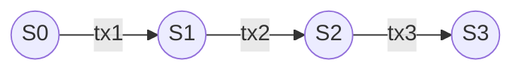
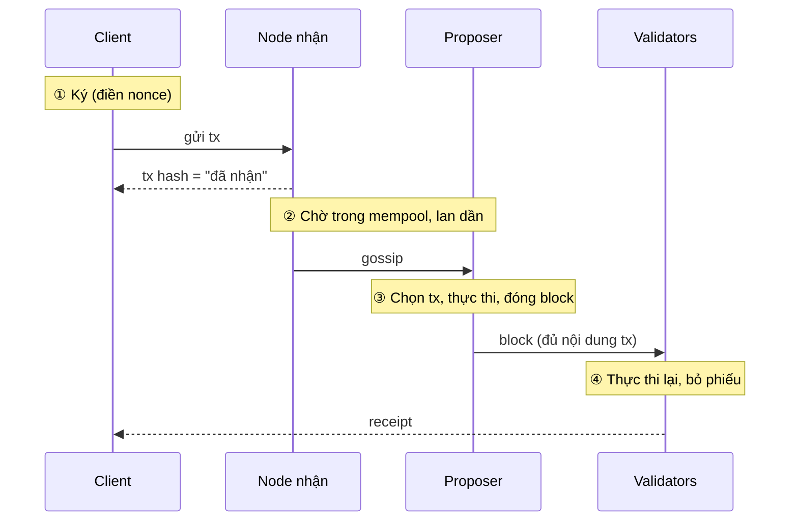
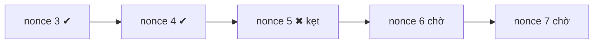
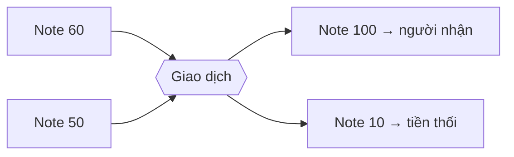
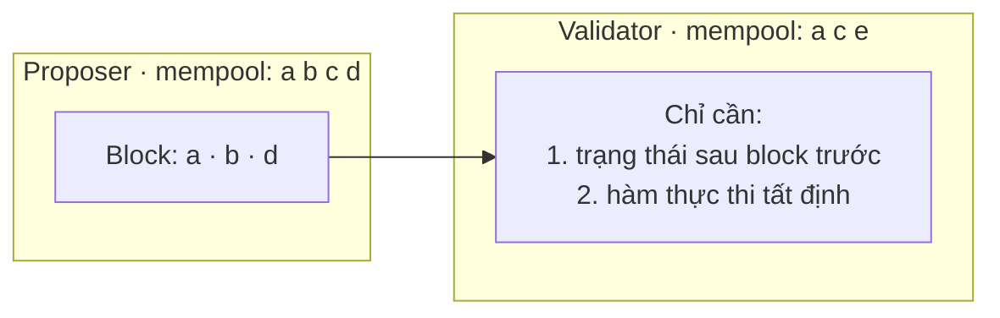
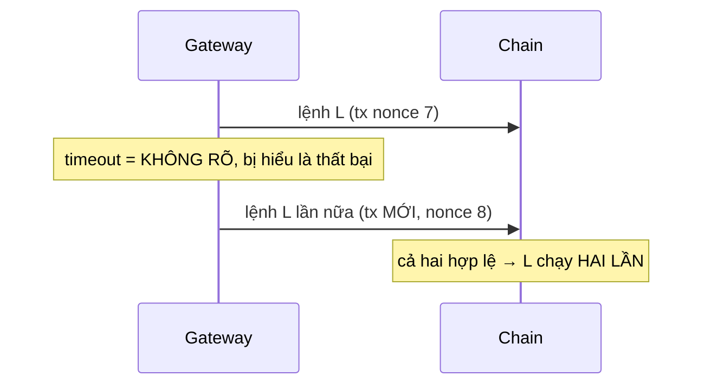

# Vòng đời một transaction: từ nonce, mempool, block time đến tính đúng đắn trong wCBDC

*Viết 2026-11-17. Bản slide đi kèm: `2026-11-17-vong-doi-transaction-block-time-va-tinh-dung-dan-slides.html`.*

Năm thắc mắc về block time, nonce, mempool và "chain như một database" có chung một gốc: **một transaction đi qua những đâu, và vì sao**. Bài dựng lại con đường đó, mỗi thắc mắc được trả lời tại đúng chặng nó nằm.

## 1. Gốc: nhiều máy, một cuốn sổ



Nếu việc cập nhật sổ là **tất định**, các máy không cần so sổ với nhau. Chúng chỉ cần chạy cùng dãy giao dịch, cùng thứ tự. Bài toán thu về một việc: **thống nhất thứ tự**.

| Bộ phận | Vai trò |
|---|---|
| **Mempool** | Phòng chờ của giao dịch chưa có thứ tự. Mỗi node một phòng riêng |
| **Block** | Một *đề xuất* thứ tự cho một lô giao dịch, kèm cam kết kết quả |
| **Đồng thuận** | Thủ tục để mọi node chấp nhận cùng một block |

Gom lô là để chia chi phí cố định của mỗi lần đồng thuận cho nhiều giao dịch. "Block time là thời gian gom batch" đến từ đây, và mới đúng một nửa (§5).

## 2. Bốn chặng của một transaction



| Chặng | Ai nắm quyền | Điều chưa được bảo đảm |
|---|---|---|
| ① Ký | Người gửi | Tx **không có timestamp**; nonce nằm trong chữ ký |
| ② Chờ | Từng node riêng lẻ | Tx có thể **rớt âm thầm** (mempool đầy, node restart) |
| ③ Thành block | Proposer của lượt đó | Thứ tự do proposer quyết; tx lỗi vẫn vào block |
| ④ Thành sự thật | Quorum validator | Block có bị đảo không? Tuỳ họ đồng thuận |

**Khi nào thì chắc chắn:** PoW không bao giờ tuyệt đối · Ethereum khoảng 13 phút · BFT **ngay khi vào block**.

## 3. Nonce (chặng ①)

**Nonce để chống phát lại. Thứ tự chỉ là hệ quả, và chỉ trong một account.**

Giao dịch kiểu account là một mệnh lệnh ("chuyển 10 từ A sang B"), thi hành lại được vô số lần. Nonce là bộ đếm biến mỗi chữ ký thành dùng một lần. Nó sinh ở local vì nằm trong phần được ký: node không điền thay được.



Cái giá: mỗi account là **một hàng dọc**. Một tx kẹt thì mọi tx sau kẹt theo. Hai tiến trình chung một khoá sẽ lấy trùng số.

**UTXO không cần nonce**, vì giao dịch tiêu *đúng những tờ tiền cụ thể*:



| | Account + nonce | UTXO |
|---|---|---|
| Chống phát lại | Bộ đếm | Mỗi output tiêu một lần |
| Thứ tự | Một hàng dọc | Đồ thị phụ thuộc, còn lại song song |
| Khi tranh chấp | Kẹt cả hàng | Một bên thua, dựng lại |

> **Hệ wCBDC có cả hai tầng:** note riêng tư trên Paladin là UTXO, còn việc ghi lên Besu vẫn là tx EVM có nonce. Tranh chấp xảy ra được ở cả hai nơi.

## 4. Mempool lệch nhau (chặng ②)

**Không làm hỏng đồng thuận.** Các node đồng thuận về *block*, không về mempool, và block mang đủ nội dung giao dịch.



| Lệch mempool chỉ gây | Đồng thuận thật sự khó vì |
|---|---|
| Độ trễ không đều | Mạng chậm hoặc đứt |
| Proposer nắm quyền thứ tự | Node gian lận |
| Tx rớt âm thầm | **Thực thi không tất định** (lệch phiên bản → chain tách hoặc đứng) |

## 5. Block time: config có sàn (chặng ③④)

Ba thứ hay bị gọi chung một tên:

| | Là gì | Ai quyết |
|---|---|---|
| **Nhịp đặt ra** | Độ khó (PoW), slot 12 s (Ethereum), `blockperiodseconds` (QBFT) | Con người |
| **Ngân sách vật lý** | dựng block + lan block + thực thi lại + bỏ phiếu + ghi đĩa | Mạng, CPU, đĩa |
| **Block time thực tế** | `≈ max(nhịp, ngân sách) + các vòng hỏng` | Hệ quả |

```text
Nhịp xa trên sàn   [dựng|lan|chạy lại|phiếu|ghi|░░░░░░ chờ, gom giao dịch ░░░░░░]   ← "thời gian gom batch"
Nhịp sát sàn       [dựng|lan|chạy lại|phiếu|ghi]                                    ← hạn chót cho cả mạng
Nhịp dưới sàn      [dựng|lan|chạy lại|▓▓ tràn hạn ▓▓]                               ← config mất ý nghĩa
                                      ▲ nhịp đặt ra
```

Lan truyền **giao dịch** không nằm trong ngân sách. Nó chỉ quyết định giao dịch kịp chuyến block nào.

## 6. Hạ block time thì sao

**Dưới sàn, hệ không nhanh hơn mà hỏng, mỗi họ một kiểu:**

| Họ | Triệu chứng | Hậu quả |
|---|---|---|
| PoW | Rẽ nhánh liên tục | Công suất trung thực lãng phí, kẻ tấn công cần < 50% |
| PoS theo slot | Lỡ slot, phiếu trễ, reorg ngắn | Validator yếu bị thiệt, tập trung hoá |
| BFT | Đổi vòng liên tục | Block time **dài hơn và giật**, nhưng không gì bị đảo |

**Trên sàn vẫn phải trả giá:** với PoW, block nhanh gấp 10 cần gấp 10 confirmation cho cùng độ an toàn · thông lượng không tự tăng, nút cổ chai dời sang thực thi · block rỗng vẫn tốn chi phí · dung sai sự cố mỏng đi.

Thứ người dùng cảm nhận là **độ trễ**, không phải block time:

```text
BFT              [lan|chờ block|xử lý|client]
PoW / Ethereum   [lan|chờ|xử lý|▓▓▓▓▓▓▓▓▓▓▓▓ chờ finality ▓▓▓▓▓▓▓▓▓▓▓▓|client]
```

**Đòn bẩy đúng, theo thứ tự:** ① đổi loại finality (BFT) → ② hạ cái sàn (validator gần nhau, mạng ổn định) → ③ rồi mới hạ nhịp, chừa biên → ④ nhìn phần ngoài chain (các bước Paladin nhiều khả năng nặng hơn nhịp 1 s của Besu).

> **Bài học dự án:** cụm khai `emptyBlockPeriod: 30s` nhưng đo ra khoảng 10 s. Con số dùng để suy luận phải là con số đo được.

## 7. Chain như một database

Eviction ẩn, latency cao, nhiều trạng thái đều mọc từ **ba gốc**:

| Gốc | So với DB | Sinh ra |
|---|---|---|
| **Commit bất đồng bộ** | `COMMIT` trả về là xong; chain thì "gửi" và "được ghi" tách rời | Rớt âm thầm, kẹt nonce, nhiều trạng thái |
| **Không có giao dịch tương tác** | Đọc ở block N, chạy ở block N+k | Mọi "kiểm tra rồi ghi" phải nằm **trong contract** |
| **Mọi node làm lại mọi việc** | Không scale ngang | Latency cao; thêm node bền hơn chứ không nhanh hơn |

Hay bị bỏ sót: vào block mà vẫn revert · đồng hồ thô do proposer ghi · không rollback · mất khoá là mất quyền · cần indexer ngoài để đọc.

Chỗ nó hơn: mọi giao dịch chạy nối tiếp theo thứ tự toàn cục, và nhiều tổ chức không tin nhau cùng giữ một sổ. Không cần đúng tính chất này thì dùng database.

## 8. Permissioned chain đổi được gì

Biết danh sách validator → đếm được phiếu → dùng được BFT thay cho xổ số.

| ✅ Biến mất | ⚠️ Ở lại nguyên vẹn | 🆕 Mới xuất hiện |
|---|---|---|
| Reorg | Commit bất đồng bộ | **Mất quorum là đứng hẳn** (4 validator: mất 2) |
| Finality xác suất | Mempool đuổi tx âm thầm | Trên 1/3 gian lận: có thể chốt hai lịch sử |
| Chờ k confirmation | Kẹt nonce, hở nonce | Một phần mềm, một phiên bản: một bug cho tất cả |
| Thị trường phí | Vào block nhưng revert | Quản trị nhiều bên |

Cột giữa là chỗ dễ chủ quan nhất: sang permissioned không làm ứng dụng đơn giản đi bao nhiêu. Xem thêm [QBFT](./QBFT) và [định danh, vòng đời node](./2026-08-22-dinh-danh-node-permissioned-them-va-restart-node).

## 9. wCBDC: mỗi tầng giữ một thứ

Đúng = không tạo tiền ngoài phát hành · không tiêu hai lần · không mất tiền · đã quyết toán thì không đảo.

| Tầng | Phải giữ | Bằng cách |
|---|---|---|
| **Riêng tư (Paladin)** | Khả năng tiêu tiền | Sao lưu kho trạng thái riêng tư ngang với khoá; có đường thử lại khi trùng note |
| **Ứng dụng** | Không suy đoán | Chỉ tin receipt thành công trong block đã chốt; một người viết cho mỗi khoá; tự chặn tải |
| **Contract** | Bất biến | Bảo toàn tổng cung, mỗi note tiêu một lần; invariant và fuzz; quy trình sửa sai bằng tx bù |
| **Đồng thuận** | Finality là thật | Khoá validator trong HSM; không site nào đủ quorum một mình; cùng phiên bản; **chấp nhận chain dừng** |

**Cái bẫy tinh tế nhất: nonce không cho bạn idempotency.**



Ứng dụng có **ba** kết cục chứ không phải hai: thành công, thất bại có ghi nhận, và *không rõ*. Cách chặn: mỗi lệnh mang một khoá idempotent mà **chính contract kiểm tra**. UTXO giúp một phần, vì lệnh lặp tiêu cùng note thì tự vô hiệu.

## 10. Trả lời năm thắc mắc

| Thắc mắc | Trả lời |
|---|---|
| Hạ block time để confirm nhanh hơn? | Chỉ khi còn trên ngân sách vật lý. Dưới đó hệ hỏng. Đòn bẩy thật là loại finality |
| Nonce để sắp thứ tự? | Để chống phát lại; thứ tự là hệ quả, chỉ trong một account. UTXO: output tiêu một lần |
| Mempool lệch có sao không? | Không hỏng đồng thuận. Chỉ gây trễ, trao quyền thứ tự cho proposer, tx rớt âm thầm |
| Block time là config hay hệ quả? | Config có sàn: `≈ max(nhịp, ngân sách)`. Lan truyền tx không nằm trong ngân sách |
| Chain như DB, permissioned, wCBDC? | Gốc là commit bất đồng bộ. Permissioned xoá reorg, thêm "dừng khi mất quorum". wCBDC: bất biến trong contract, chỉ tin receipt đã chốt, idempotent ở tầng nghiệp vụ |
