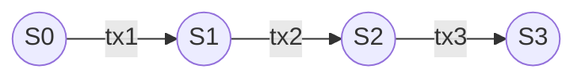
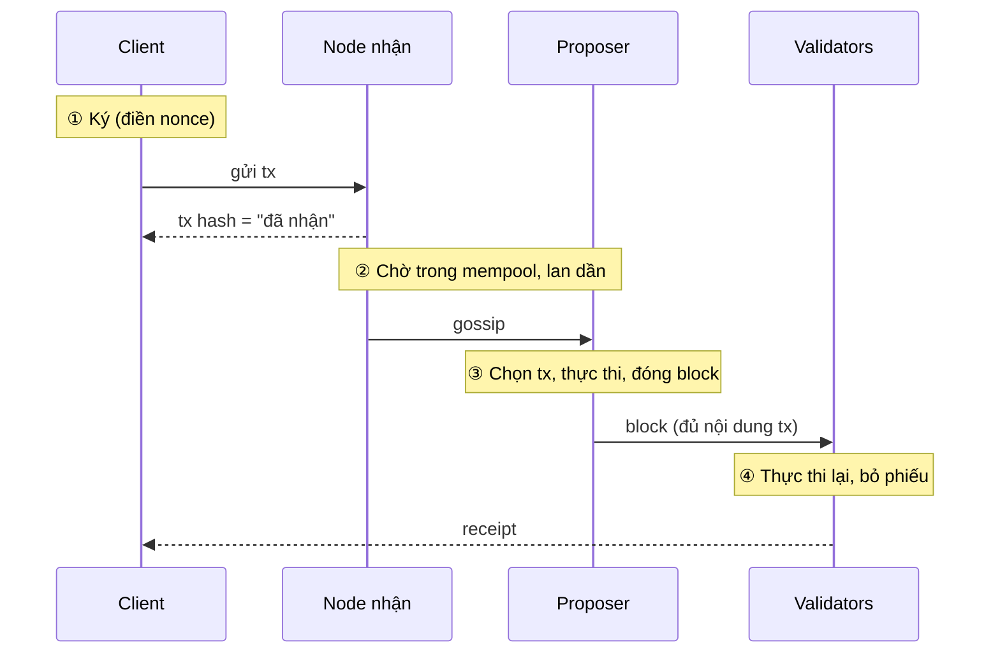
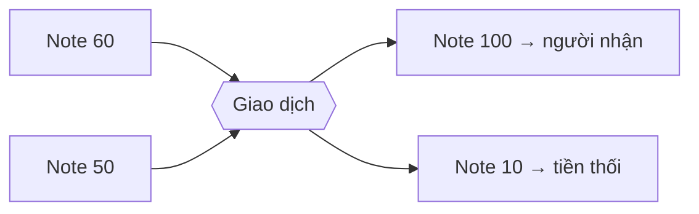

# Vòng đời một transaction: từ nonce, mempool, block time đến tính đúng đắn trong wCBDC

Bài này bắt đầu từ năm thắc mắc tưởng như rời nhau. Hạ block time xuống để confirm nhanh hơn thì chuyện gì xảy ra, khi block time có vẻ chỉ là thời gian gom batch? Nonce có phải để sắp thứ tự giao dịch không, sao lại sinh được ở local, và UTXO thì dùng gì thay? Mempool các node lệch nhau thì đồng thuận có hỏng không? Block time là một config hay là hệ quả của tổng các độ trễ? Và nếu coi blockchain là một database thì nó tệ hơn ở đâu, permissioned chain có thoát được không, wCBDC phải chú ý gì?

Năm câu này có chung một gốc: **một transaction đi qua những đâu, và vì sao phải đi qua đó**. Vì vậy bài dựng lại con đường ấy trước (§1–§2), rồi trả lời từng thắc mắc tại đúng chặng nó nằm (§3–§9).

## 1. Gốc: nhiều máy, một cuốn sổ

Bài toán gốc là nhiều máy của nhiều tổ chức cùng giữ một cuốn sổ, không máy nào được một mình quyết nội dung. So sổ liên tục với nhau thì không khả thi vì sổ lớn và thay đổi liên tục. Lối thoát nằm ở một quan sát: nếu việc cập nhật sổ là **tất định** (cùng trạng thái, cùng giao dịch thì máy nào cũng ra cùng kết quả), các máy chỉ cần chạy cùng một dãy giao dịch theo cùng một thứ tự là tự khắc giống nhau.



Nhờ đó toàn bộ bài toán thu về một việc duy nhất: **thống nhất thứ tự**. Ba khái niệm quen thuộc chỉ là ba bộ phận của cỗ máy làm việc đó:

| Bộ phận | Vai trò |
|---|---|
| **Mempool** | Phòng chờ của giao dịch chưa có thứ tự. Mỗi node một phòng riêng |
| **Block** | Một *đề xuất* thứ tự cho một lô giao dịch, kèm cam kết về kết quả |
| **Đồng thuận** | Thủ tục để mọi node chấp nhận cùng một block |

Vì sao gom lô mà không thống nhất từng giao dịch? Vì mỗi lần thống nhất tốn chi phí cố định (vài vòng tin nhắn, chữ ký, ghi đĩa), nên gom lô để chia chi phí ấy ra. Trực giác "block time là thời gian gom batch" sinh ra từ đây.

## 2. Bốn chặng của một transaction



**① Ký.** Client dựng giao dịch: người nhận, giá trị, dữ liệu, giới hạn gas , điền nonce và ký lên tất cả. Hai chi tiết sẽ quay lại về sau: giao dịch **không mang timestamp** (thời gian chỉ có ở header block, do người đóng block ghi), và nonce nằm **trong phần được ký** nên không node nào sửa được.

**② Chờ.** Node nhận kiểm tra chữ ký, nonce, đủ tiền trả gas, cho giao dịch vào mempool của mình và trả về tx hash. Tx hash chỉ có nghĩa "node này đã nhận". Giao dịch lan dần sang các peer khác, và sau một lúc *phần lớn* node có giao dịch này nhưng không bảo đảm mọi node đều có nó. Mempool lại có giới hạn: đầy thì đuổi bớt, restart thì mất và đây là trong phân tán nên không biết được tx nào đến trước sau rõ ràng. Đây là chặng mà giao dịch có thể biến mất không ai báo.

**③ Proposal.** Mỗi độ cao có một node được quyền đề xuất phụ thuộc vào các họ đồng thuận: người giải được bài băm (PoW), validator được chọn cho slot (PoS), hoặc người đến lượt xoay vòng (BFT). Node đó lấy giao dịch **từ mempool của chính mình**, tự sắp thứ tự (giao thức chỉ buộc đúng thứ tự nonce trong từng account, còn lại là policy của phần mềm node, thường là phí cao đi trước, bằng phí thì theo thứ tự tx nào tới node trước. Ở ethereum: phần lớn người đề xuất thuê bên dựng block chuyên nghiệp, và họ sắp sao cho thu lợi nhất (MEV)), thực thi rồi đóng block (ghi kết quả vào header dưới dạng một cam kết gọi là state root). Giao dịch chạy lỗi vẫn nằm trong block và vẫn tốn nonce. Block phát đi mang **đủ nội dung giao dịch**, không chỉ hash.

**④ Thành sự thật.** Mỗi validator (được chọn cơ chế tùy mạng) tự thực thi lại block (chứ không tra mempool của mình, khi đó tx ấy lan tới sau trên node đó bị bỏ vì nonce đã cũ) và so kết quả state root; không ai tin người đề xuất. Khớp thì bỏ phiếu, đủ quorum thì ghi vào chain. Nếu người đề xuất chết hoặc quá chậm, các validator hết kiên nhẫn sau một timeout, chuyển sang người kế tiếp và làm lại.

Còn một câu hỏi: block đã ghi thì có bị đảo không? Câu trả lời tuỳ họ đồng thuận, và sẽ là mấu chốt của nửa sau bài: PoW không bao giờ chắc tuyệt đối, Ethereum chắc sau khoảng 13 phút, còn BFT chắc **ngay khi vào block**.

## 3. Nonce (chặng ①)

Trực giác "nonce để sắp thứ tự" gần đúng nhưng đảo nhân quả. Giao dịch kiểu account là một *mệnh lệnh* ("chuyển 10 từ A sang B"), và mệnh lệnh thì thi hành lại được bao nhiêu lần cũng xong: Nonce sinh ra để chặn việc ai bắt được giao dịch đã ký đều phát lại được. Mỗi account có một bộ đếm, giao dịch mang nonce `n` chỉ hợp lệ khi bộ đếm đang bằng `n`, nên mỗi chữ ký chỉ dùng được một lần => nonce là một cơ chế rất quan trọng để đạt được idempotency ở cấp transaction và chống double spend ở cấp account

**Thứ tự là hệ quả của cơ chế chống phát lại**, và chỉ có hiệu lực *trong một account*. Giữa hai account, thứ tự do người đề xuất block quyết; đó là gốc của front-running. Còn việc nonce sinh ở local thì không phải là "được" mà là "buộc phải": nó nằm trong phần được ký, chỉ người giữ khoá mới điền được.

Cái giá là mỗi account thành **một hàng dọc**:


Một giao dịch kẹt thì mọi giao dịch sau nó kẹt theo. Hở một số thì các số sau chờ vô thời hạn. Hai tiến trình dùng chung một khoá sẽ lấy trùng số, và một bên thua. Và nếu gửi lại cùng một số, đó là *thay thế* giao dịch cũ chứ không phải thêm giao dịch mới

**UTXO giải bài toán chống phát lại theo cách khác hẳn.** Ở đó không có số dư, chỉ có các "tờ tiền" riêng lẻ, và 1 giao dịch không nói "trừ 10 của A", mà nói "tiêu *đúng tờ này* và tạo ra các tờ mới"



Phát lại giao dịch này thì hai tờ đầu vào đã tiêu rồi, nên nó vô nghĩa; không cần bộ đếm. Thứ tự cũng đổi bản chất: không còn là dãy số mà là quan hệ phụ thuộc (tiêu một tờ phải sau khi tạo ra tờ đó). Hai giao dịch không đụng chung tờ nào thì không có thứ tự gì với nhau và chạy song song được.

| | Account + nonce | UTXO |
|---|---|---|
| Chống phát lại | Bộ đếm | Mỗi output tiêu một lần |
| Thứ tự | Một hàng dọc | Đồ thị phụ thuộc, còn lại song song |
| Khi tranh chấp | Kẹt cả hàng | cái vào block trước thắng |

Hệ thống paladin + besu có **cả hai tầng**: note riêng tư trên Paladin là UTXO, nhưng việc ghi lên Besu vẫn là giao dịch EVM có nonce. Tranh chấp vì thế có thể xảy ra ở cả hai nơi: hai lệnh chọn trùng một note, hoặc hàng nonce của account nộp giao dịch bị kẹt.

## 4. Block time

Hình dung một chain không có block time: block trước vừa ghi xong là dựng ngay block sau. Khoảng cách giữa hai block khi đó bằng đúng thời gian **làm** một block (dựng, lan đi, thực thi lại, bỏ phiếu, ghi đĩa), và không ai đặt được nó: mạng, CPU và đĩa quyết => chi phí cố định của mỗi block không được chia cho ai, và trên mạng mở block còn ra nhanh hơn tốc độ nó lan đi. Nên mọi giao thức đều cố tình chèn thêm một quãng **chờ**. Block time vì thế gồm hai phần khác bản chất: *làm* là vật lý, *chờ* là lựa chọn.

```text
block N ──[ CHỜ ░░░░░░░░ ]──[ dựng → lan → thực thi lại → PREPARE → COMMIT → ghi ]── block N+1
            ▲ config ở đây     ▲ không có lịch: xong bước trước là chạy ngay bước sau
```

Chỉ có một điểm hẹn giờ, ở đầu chu kỳ. Phần sau không phải một lịch trình: chọn người đề xuất là một phép tính ai cũng tự ra cùng kết quả, mempool đã được xếp sẵn từ lúc giao dịch tới, nên thứ thật sự tốn thời gian là thực thi và các chặng mạng. Lan truyền *giao dịch* thì nằm ngoài chu kỳ: nó chỉ quyết định giao dịch kịp chuyến nào.

Thứ điểm giờ ở đầu chu kỳ khác nhau theo từng họ, và đó là lý do "config block time" ở mỗi họ mang một nghĩa:

| Họ | Thứ nói "bây giờ" | Config nghĩa là | Đo trên chain |
|---|---|---|---|
| PoW | Ai đó trúng xổ số | Mục tiêu trung bình | Từng block ngẫu nhiên; chỉ trung bình dài hạn khớp |
| Ethereum PoS | Đồng hồ treo tường | Độ dài slot | Luôn là bội của 12 s (24 khi lỡ slot) |
| QBFT | Hẹn giờ từ block trước | Khoảng cách **tối thiểu** | Không bao giờ nhỏ hơn config; lớn hơn khi block rỗng, đổi vòng, hoặc làm không kịp |

Với QBFT, config đặt *mốc* được phép đề xuất chứ không đặt độ dài quãng chờ. Phần làm ăn vào quãng đó, nên quãng chờ tự co lại để bù, cho tới khi không còn gì để co:

```text
block time thực tế ≈ max(nhịp đặt ra, thời gian làm) + thời gian mất cho các vòng hỏng
```

Từ công thức này, cùng một con số config có ba nghĩa tuỳ vị trí của nó so với thời gian làm. Xa phía trên (Bitcoin: 10 phút so với vài giây), gần cả chu kỳ là chờ, và block time đúng là **thời gian gom batch**. Sát thời gian làm, quãng chờ biến mất và nhịp thành **hạn chót** cho cả mạng. Thấp hơn nữa thì nó **không còn quyết định gì**. Block time là một config có sàn: ra lệnh được cho quãng chờ, không ra lệnh được cho phần việc.

Một lưu ý khi đo: "thời gian của block" là số người đề xuất tự ghi vào header, theo đồng hồ của họ và làm tròn tới giây, nên con số trên chain chỉ gần đúng ngay cả khi mọi thứ khớp.

## 5. Hạ block time thì sao

Câu trả lời chia hai trường hợp. **Nếu nhịp mới rơi xuống dưới sàn**, hệ không nhanh hơn mà hỏng, mỗi họ một kiểu:

| Họ | Cơ chế | Hậu quả |
|---|---|---|
| PoW | Block chưa lan hết, nơi khác đã đào ra block cùng độ cao | Rẽ nhánh; công suất trung thực lãng phí nên kẻ tấn công cần < 50% , thợ đào lớn và kết nối tốt ít bị thiệt hơn => tập trung hoá |
| PoS theo slot | Block tới sau hạn bỏ phiếu bị coi như không có | Lỡ slot, reorg ngắn; validator yếu hoặc ở xa bị thiệt => tập trung hoá |
| BFT | Không đủ phiếu trước timeout nên đổi người đề xuất | Block time **dài hơn và giật**, nhưng không gì bị đảo |

Điểm chung: đồng thuận cần thời gian tỷ lệ với độ trễ mạng, không tỷ lệ với mong muốn. BFT đánh đổi dễ chịu nhất: đặt sai chỉ làm chậm, không làm sai.

**Nếu vẫn còn trên sàn**, hệ chạy ổn nhưng không được lợi nhiều. Với PoW, độ an toàn đo bằng lượng công việc chồng lên chứ không phải số block, nên block nhanh gấp 10 thì cần gấp 10 confirmation: con số nhảy nhanh hơn, thời gian chờ thật gần như không đổi. Thông lượng cũng không tự tăng, vì nút cổ chai chỉ dời từ đồng thuận sang thực thi và đĩa. Thêm vào đó, mỗi block rỗng vẫn tốn chi phí cố định, và dung sai cho sự cố mỏng đi.

Lý do sâu hơn là thứ người dùng cảm nhận là **độ trễ tới lúc chắc chắn**, và block time chỉ là một số hạng trong đó:

```text
BFT              [lan|chờ block|xử lý|client]
PoW / Ethereum   [lan|chờ|xử lý|▓▓▓▓▓▓▓▓▓▓▓▓ chờ finality ▓▓▓▓▓▓▓▓▓▓▓▓|client]
```

Với BFT, finality bằng không nên block time chi phối gần hết. Với PoW và Ethereum, finality là số hạng lớn nhất và block time gần như không chạm tới nó. Từ đó suy ra thứ tự đòn bẩy nếu mục tiêu thật là "chắc chắn nhanh hơn":

Vậy nếu mục tiêu thật là "chắc chắn nhanh hơn", đòn bẩy nằm ở đâu? Trước hết là **đổi loại finality** chứ không phải đổi nhịp: BFT cho chắc chắn sau một block, và đó là lý do chính các mạng thanh toán liên ngân hàng chọn nó. Kế đến là hạ chính cái sàn: đặt validator gần nhau, mạng ổn định, block vừa đủ nhỏ. Sau đó mới hạ nhịp xuống sát sàn, có chừa biên. Và cuối cùng, nhìn vào phần ngoài chain: trong hệ này, nhiều khả năng các bước của Paladin (dựng giao dịch, xin xác nhận, notary) chiếm phần lớn độ trễ hơn là nhịp 1 giây của Besu.
Con số block time dùng để suy luận phải là con số đo được, không phải con số chép từ config.

## 6. Chain như một database

Đến đây có thể nhìn lại nhận xét: so với database truyền thống, chain dễ lỗi hơn, có eviction ẩn, có reorg, latency cao, nhiều trạng thái phức tạp. 

| Gốc | Khác database ở đâu | Sinh ra |
|---|---|---|
| **Commit bất đồng bộ** | `COMMIT` trả về là xong; trên chain "gửi" và "được ghi" tách rời | Rớt âm thầm, kẹt nonce, nhiều trạng thái trung gian |
| **Không có giao dịch tương tác** | Đọc ở block N, ký, rồi chạy ở block N+k trên trạng thái đã khác | Mọi "kiểm tra rồi ghi" phải nằm **trong contract** |
| **Mọi node làm lại mọi việc** | Không ai tin ai nên ai cũng thực thi lại, tuần tự | Latency cao; thêm node bền hơn chứ không nhanh hơn |

Ngoài ba gốc còn vài thứ hay bị bỏ sót: giao dịch có thể vào block mà vẫn thất bại; đồng hồ của chain thô và do người đề xuất ghi; không có rollback nên lỗi logic là vĩnh viễn; mất khoá là mất quyền; và muốn đọc tử tế phải có indexer bên ngoài.

Công bằng mà nói, chain có một chỗ *mạnh hơn* đa số database: mọi giao dịch chạy nối tiếp theo một thứ tự toàn cục, tức mức cô lập cao nhất. Điểm yếu nằm ở giao diện với client chứ không ở mô hình nhất quán. Và nó cho thứ database không cho được: nhiều tổ chức không tin nhau cùng giữ một sổ. Nếu bài toán không cần đúng tính chất ấy, database luôn tốt hơn.

## 7. Permissioned chain đổi được gì

Câu hỏi kế tiếp: trong các rắc rối trên, cái nào do *blockchain*, cái nào chỉ do *public* blockchain? Khác biệt gốc nằm ở giả định. Chain công khai không biết có bao nhiêu node nên không đếm phiếu được, đành dùng xổ số (đốt điện, khoá vốn) và chấp nhận sự chắc chắn mang tính xác suất. Chain permissioned **biết danh sách validator**; biết danh sách thì đếm được phiếu, và đếm được phiếu thì dùng được BFT.

Từ đó, một nhóm rắc rối **biến mất hẳn**: không còn reorg, không còn finality xác suất, không còn chuyện chờ k confirmation, không còn thị trường phí. Đường đi của một giao dịch ngắn lại đáng kể, vì "vào block" và "chắc chắn" trở thành một.

Nhưng một nhóm khác **ở lại nguyên vẹn**, vì chúng là thuộc tính của mô hình mempool và account. Commit vẫn bất đồng bộ và tx hash vẫn không phải lời hứa. Mempool vẫn có giới hạn và vẫn đuổi giao dịch âm thầm. Nonce vẫn kẹt. Giao dịch vẫn có thể vào block mà thất bại. Khe hở giữa lúc đọc và lúc thực thi vẫn còn. Thực thi vẫn tuần tự. Đây là điểm dễ chủ quan nhất: chuyển sang permissioned không làm ứng dụng đơn giản đi bao nhiêu.

Và có một nhóm **mới xuất hiện**. Quan trọng nhất: BFT chọn an toàn và bỏ sẵn sàng. Mất quá một phần ba validator (với bốn validator là mất hai) thì chain đứng hẳn. Với tiền tệ đó là hành vi đúng, thà dừng còn hơn ghi sai, nhưng nó biến một sự cố hạ tầng thành sự cố toàn hệ, và làm cho cách đặt validator qua các trung tâm dữ liệu trở thành quyết định về tính đúng đắn. Kế đó là giả định tin cậy cứng: an toàn chỉ đúng khi dưới một phần ba validator gian lận hoặc bị chiếm khoá. Vượt ngưỡng ấy thì hậu quả không phải là chậm, mà là có thể chốt hai lịch sử khác nhau. Cuối cùng, mạng ít node thường chạy một phần mềm một phiên bản, nên một bug là bug của tất cả; và việc thêm bớt validator, nâng cấp phần mềm trở thành quy trình quản trị nhiều bên.